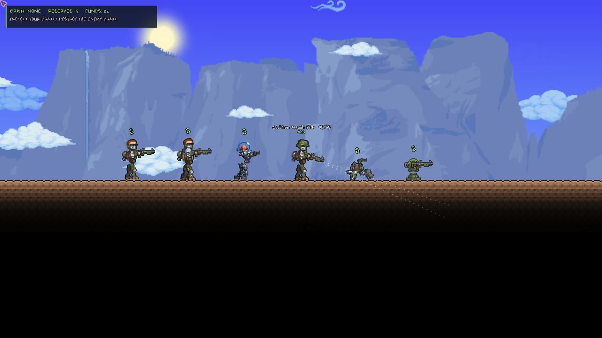

# Native CC artwork at 2× — working 0.13.0

The chosen terrain grid remains **8×8 visible art pixels per Terraria tile**. One cell is 2×2 world pixels. Native Cortex Command artwork now draws at 2×, making one CC sprite pixel the same size as one Terraria art pixel. There is no 1-world-pixel terrain migration.

## What changed

Actor torsos, heads, jetpack, crab body and turret parts now import at native source dimensions instead of being fitted to prototype dimensions. Complete native limb frames remain native files. The renderer builds a pose in native coordinates, then transforms its positions and sprites into world coordinates together. Imported weapons, loose equipment, grenades, detached limbs and vehicle wrecks follow the same scale. Existing Terraria equipment keeps its existing texture scale; inventory icons keep their UI scale.

Collision geometry, limb paths, hands, feet, reach, posture envelopes, craft hulls, attachments, bays and pilot exits use the matching world scale. Rocket leg frames and angles follow the native contracted/extended offsets and ankle direction, fixing their previously horizontal, floating appearance. Native sprite geometry and the existing adapted actor rig offsets remain separate from a claim of complete CC actor-preset parity.

The conversion is now **40 Terraria world pixels per metre**, retaining CC's native 20 sprite pixels per metre and 60Hz tick rate. Walking, gravity, jet impulses, firearm muzzle speeds, throws and camera reach convert accordingly. Mass in kilograms, forces in newtons, impulse thresholds in N·s, health, reload time and jetpack fuel time do not double. A cursor inside a long barrel no longer makes a shot reverse back toward the cursor.

| Entity | World dimensions / standing envelope |
| --- | --- |
| Canonical soldier / Light / Brain | 84px standing height; humanoid body width 28px |
| Heavy | 88px standing height, accounting for its native head/neck placement |
| Rocket | 80×210px envelope |
| Dropship | 352×172px envelope |

Normal standing clearance is about six Terraria tiles. Existing three-tile doors and low rooms will not accommodate these bodies at full height. The enemy bunker's doorway is taller for the enlarged infantry; existing player structures are not rewritten.

At this conversion, a terrain cell corresponds to **one native CC pixel**, so its material resistance uses one source pixel's integrity rather than four. Tile occupancy masks remain 64 bits. Existing fracture saves record their source cell area; older partial fracture work is migrated proportionally so its completed fraction survives. Mixed materials inside one Terraria tile remain unfinished.

Body snapshots record their scale. Old reserve-body saves preserve their world anchor while scaling velocity and limb/contact offsets to retain physical units. Current-scale swaps do not scale the same body twice. Old character anatomy, wounds and inventories remain readable. Multiplayer peers need the same 0.13.0 build because body snapshot payloads changed.

## Preview and testing

`tools/testenv/scenarios/scale-preview.txt` captures an actor lineup, rocket and dropship against unchanged Terraria terrain. The craft land on a protected pad for a readable scale comparison; yielding soil can still be excavated by a hard landing and strand a craft. The scale preview is an actual in-game capture, not a mockup.



[View rocket](native-2x-rocket.png) · [View dropship](native-2x-dropship.png)

Validation: the Release build succeeds with four existing warnings. All 187 standalone physics checks pass. In-game scenes pass 104 assertions across scale preview (9), actor movement (40), sentry combat (6), unit orders (13), wounds (24), body handoff (8) and projectile limb hits (4). A dedicated server with two clients also passes all 18 craft checks, covering boarding, pilot mass, flight replication and leaving the ship. These are focused checks for this change; the entire older scenario collection has not been rerun at the new scale.

The standalone physics checks now use the new world conversion for their metre-based fixtures. They also cover source-pixel terrain resistance, unchanged physical impact momentum, old-save scale migration, current-scale handoff and native rocket gear orientation.

```sh
PATH="$HOME/.dotnet:$PATH" dotnet run --project tools/physics-tests -c Release
tools/testenv/run.sh tools/testenv/scenarios/scale-preview.txt --build
tools/testenv/run-mp.sh tools/testenv/mp/craft --timeout 240
```

This changes the conversion's visual and physical scale. It does not complete sprite-level armour penetration, articulated dynamic-body collisions, particle-based thrust or the other damage/physics gaps documented in the prior stages.
